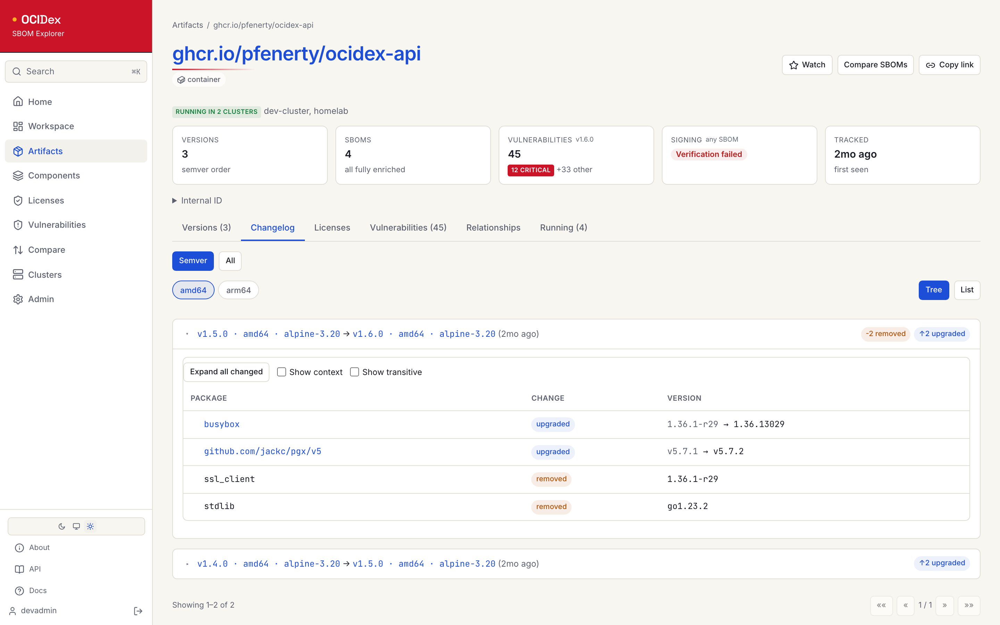

# OCIDex

**Know what you ship, and what you run.**

OCIDex keeps every SBOM of your container images and software, and tells you what is in them,
what changed between versions, what is vulnerable today, and what is running in your clusters.

**[Documentation](https://docs.ocidex.app)** ·
[Quickstart](https://docs.ocidex.app/getting-started/quickstart/) ·
[Concepts](https://docs.ocidex.app/concepts/overview/) ·
[Install](https://docs.ocidex.app/guides/operate/install/) ·
[API](https://docs.ocidex.app/guides/integrate/api/)

<p align="center">
  
</p>

## What it does

- **Collects SBOMs.** Scans your container registries itself, or takes CycloneDX SBOMs from CI,
  the CLI or the API. Every version is kept, per architecture and base distribution.
- **Diffs any two versions.** A changelog for every artifact, and a diff between any two SBOMs,
  drawn as a dependency tree.
- **Keeps vulnerabilities current.** Matched against the grype database and re-matched daily, so a
  new CVE shows up on an image you scanned months ago, with no rescan.
- **Knows what is running.** An agent reports what each Kubernetes cluster runs. OCIDex shows how
  much of it is assessed, and scans the rest.
- **Searches everything.** Every package, version and license across every SBOM.
- **Fits your access model.** Namespaces, five roles, GitHub or any OIDC provider, and scoped API
  keys.

## Try it

You need Docker, git and make:

```sh
git clone https://github.com/pfenerty/ocidex.git
cd ocidex
make demo
```

Open `http://localhost:3000` and sign in as **demo-admin**. The
[quickstart](https://docs.ocidex.app/getting-started/quickstart/) takes you from there to a
scanned image, its vulnerabilities and a diff.

## Documentation

Everything for using and running OCIDex is at **[docs.ocidex.app](https://docs.ocidex.app)**:

| | |
| --- | --- |
| [Get started](https://docs.ocidex.app/getting-started/quickstart/) | Run the demo and browse your first SBOM |
| [Concepts](https://docs.ocidex.app/concepts/overview/) | Artifacts, SBOMs, enrichment, diffs, namespaces and clusters |
| [User guide](https://docs.ocidex.app/guides/use/overview/) | Working in the UI |
| [Operator guide](https://docs.ocidex.app/guides/operate/overview/) | Install, configure, upgrade and operate on Kubernetes |
| [Integrator guide](https://docs.ocidex.app/guides/integrate/overview/) | The API, `ocidex-cli`, MCP and CI recipes |
| [Reference](https://docs.ocidex.app/reference/overview/) | Generated: API, configuration, Helm values, CLI, authorization |

The site's source is in [`site/`](site/). The repository's [`docs/`](docs/) holds contributor
material: architecture, development, CI and the
[Architecture Decision Records](docs/adr/).

## Contributing

See [CONTRIBUTING.md](CONTRIBUTING.md) for the development setup, workflow and conventions.

OCIDex is Go (chi, huma, pgx, sqlc), PostgreSQL, NATS JetStream and a SolidJS frontend. The
[architecture overview](docs/ARCHITECTURE.md) explains how the pieces fit.

## Releases and security

OCIDex follows [semantic versioning](https://semver.org/); what the 1.x line promises is in
[ADR-052](docs/adr/0052-v1-compatibility.md), and the per-version history in
[CHANGELOG.md](CHANGELOG.md). Every image and chart is signed and carries build provenance:
see [Verify release artifacts](https://docs.ocidex.app/guides/operate/verify-artifacts/).

To report a vulnerability, follow [SECURITY.md](SECURITY.md). Please don't open a public issue.

## AI acknowledgment

This project was built with significant AI assistance (Claude). Architecture decisions,
technology selection and code review are human-driven; implementation, refactoring and
documentation are collaborative. See [How AI was used](docs/AI.md).

## License

[MIT](LICENSE). Every container image also carries the license texts of the third-party code it
ships, at `/licenses/THIRD_PARTY_NOTICES`, and the web UI serves its own at
`/third-party-licenses.txt`.
