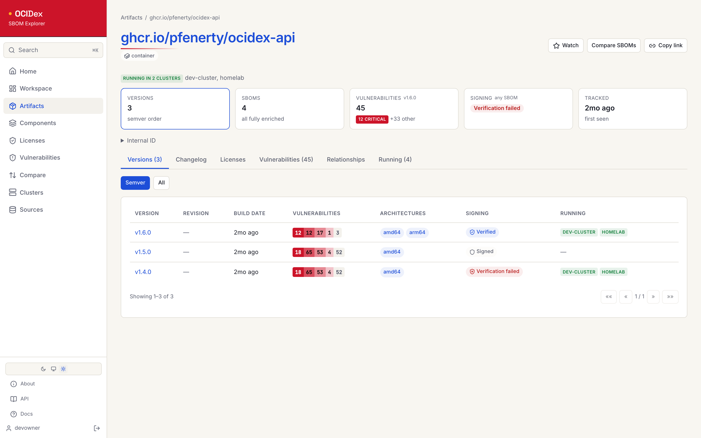
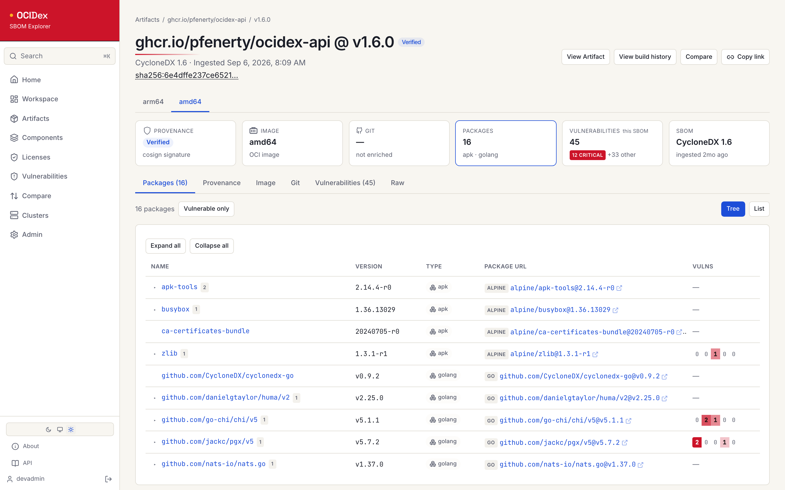
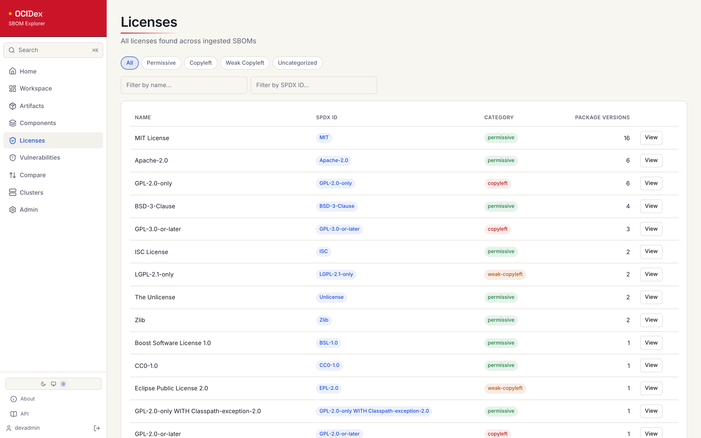

## Search

Press <kbd>⌘K</kbd> (or <kbd>Ctrl K</kbd>), or use **Search** at the top of the sidebar, to jump to
an artifact, a package, a vulnerability or a page by name.

## Artifacts

**Artifacts** lists everything OCIDex tracks that you can see. Open one to get its page:

- The header shows its versions, SBOM count, vulnerability count, whether its images are signed,
  and when it was first seen.
- **Versions** lists every SBOM, one per version and architecture. **Semver** orders them by
  version number; **All** by build time.
- **Changelog** compares each version with the one before it. See [Compare SBOMs](/guides/use/compare/).
- **Licenses** counts the latest version's components by license category.
- **Vulnerabilities** lists the advisories affecting the latest version.
- **Relationships** shows which other artifacts ship this one inside them.

**Watch** adds the artifact to [your workspace](/guides/use/workspace/). **Copy link** gives you a
link by name, which keeps working across new versions.

## An SBOM

Open a version to see one SBOM:

| Tab | What it shows |
| --- | --- |
| **Packages** | Every package, with its version, type, licenses and vulnerabilities. Switch to the dependency tree to see what pulls each one in. |
| **Provenance** | Whether the image is signed and attested, and verified against its registry's trust policy. |
| **Image** | The image's labels and annotations: title, description, source, base image and so on. |
| **Git** | The commit the image was built from, when its labels name one. |
| **Vulnerabilities** | The advisories affecting this SBOM's packages. |
| **Raw** | The CycloneDX document exactly as it was ingested. |

## Packages

**Components** searches packages across every SBOM you can see, by name, type or ecosystem. A
package's page lists each version in use and the SBOMs carrying it, which answers "where do we
use this?"

## Licenses

**Licenses** lists every license across your SBOMs, grouped as permissive, weak copyleft and
copyleft, with how many packages carry each. Open one to see which components, in which artifacts,
are under it.
