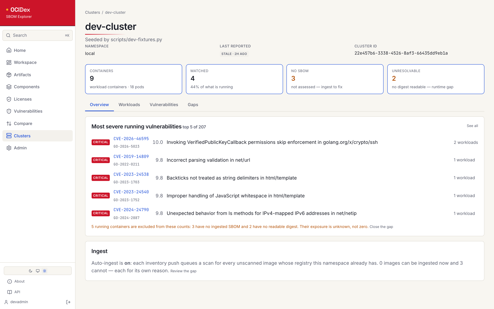

A registered cluster runs the inventory agent, which reports every running container's image.
Installing it is in the [operator guide](/guides/operate/clusters-and-operator/). The cluster page
answers one question: **what's actually running here, and what do we know about it?**

## The coverage band

Four tiles sit above the tabs and always describe the **whole cluster**, never the current filter,
so a filtered table of three clean rows can't pass for a clean cluster.

| Tile | Meaning | What to do |
| --- | --- | --- |
| **Containers** | Workload containers in the last snapshot, with the pod count beneath | |
| **Matched** | The image digest matches an ingested SBOM | Nothing: these are assessed |
| **No SBOM** | A valid registry digest, but nothing ingested for it | Ingest it: see [Gaps](#gaps) |
| **Unresolvable** | The container runtime reported no registry digest | Upgrade the node's runtime |

Containers are counted per namespace, workload, container and image, so a three-replica Deployment
is one container and three pods. Every vulnerability figure on the page counts containers.

**A vulnerability count never appears without its coverage.** If 40 of 100 containers are matched,
the counts describe those 40. The other 60 are *not assessed*, which isn't the same as clean, and
the page says so.

Before the agent's first report, the page shows install commands with this cluster's id instead
of four zeroed tiles.

## Tabs

**Overview** shows the five most severe vulnerabilities running in the cluster (headed "top 5 of N"),
how stale the last report is, and whether auto-ingest is on.

**Workloads** shows the inventory two ways, chosen with **Group by**:

- **By image** (the default): one row per running image, with the workloads and pods using it.
  Fourteen deployments of one bad image are one upgrade, so this is usually the view to act from.
- **By workload**: one row per namespace, workload and container, for "where is this running?"

Both open worst-first, and filter by Kubernetes namespace, match state and text. A row that isn't
assessed says so in words, never as a zero.

**Vulnerabilities** lists each advisory once, however many workloads run it. Expand a row to see
which ones do. An advisory's own page shows the reverse: every cluster running it.

## Gaps

The **Gaps** tab is the part of the coverage band you can fix.

**No SBOM ingested** lists images, not containers: twelve replicas of one unscanned image are one
thing to ingest. Each row says what's in the way:

| State | Meaning | What to do |
| --- | --- | --- |
| `ready to ingest` | It will be scanned, with the credentials of a registry in this namespace that serves its host, or anonymously when none does | Press **Ingest**, or let auto-ingest do it |
| `scanning` | A scan is queued or running | Wait |
| `pull refused` | The registry answered 401 or 403: the image is private and OCIDex has no working credentials | Add a registry with credentials (the link opens the form with the host filled in), then **Retry** |
| `address refused` | The registry's address is blocked by the egress policy | Ask an operator to allow it, then **Retry** |
| `scan failed` | The image wasn't there, or the scan ran out of attempts | **Retry** |
| `SBOM deleted` | Its SBOM was deleted on purpose | Rescan it from the image's page |
| `registry disabled` | The matching registry is switched off | Enable it |
| `no host in reference` | The reported image names no registry | A node runtime problem |

**Registries to configure** shows the same gap from the fix's side: one registry closes every
image behind it. Each row proposes a registry for one scope (`ghcr.io/acme`, say, since one org's
credentials don't work for another's), in the cluster's namespace, with the repositories it would
need to cover.

**No digest readable** lists containers whose runtime reported a local image id. No scan can help;
the fix is on the node.

The counts above each table describe the whole gap, not the page on screen, so **Ingest all**
queues what it says.

## Auto-ingest

Auto-ingest is **on** for every new cluster: each report queues a scan of every `ready to ingest`
image. Turn it off per cluster on the **Clusters** page (Edit, then Save).

- **Credentials come only from the cluster's namespace.** A registry in another namespace is never
  used, even for the same host.
- **Anonymous pulls are guarded** by the same egress policy as everything else, and always use
  HTTPS.
- **A registry's patterns don't limit what's running.** A registry for the host pulls a running
  image with its credentials even if its patterns exclude that repository.
- **Repeat reports cost nothing.** An image that already has a scan job isn't contacted again.
- **Refusals aren't retried automatically.** Press **Retry** to ask the registry again.

Ingesting and auto-ingest need the `push_inventory` capability in the cluster's namespace.

Ingest **queues** scans. Rows leave the gap when the scan finishes and the SBOM lands, seconds to
minutes later. A row that stays after its scan finished means the scan failed; the error is on the
**Jobs** page.

## Troubleshooting

| Symptom | Cause |
| --- | --- |
| The cluster reads *never reported* | The agent has never sent a report. That's different from running nothing. Check the agent's logs. |
| Workloads vanished after a configuration change | Each report replaces the whole inventory. Narrowing the agent's namespaces removes the others. |
| An image shows as a bare hash | The runtime reported an image id with no name, and the pod spec had none either. |
| Auto-ingest queues nothing | Check the Gaps tab: every state other than `ready` names its fix. If every row is `ready`, the installation has no scanner running. |
