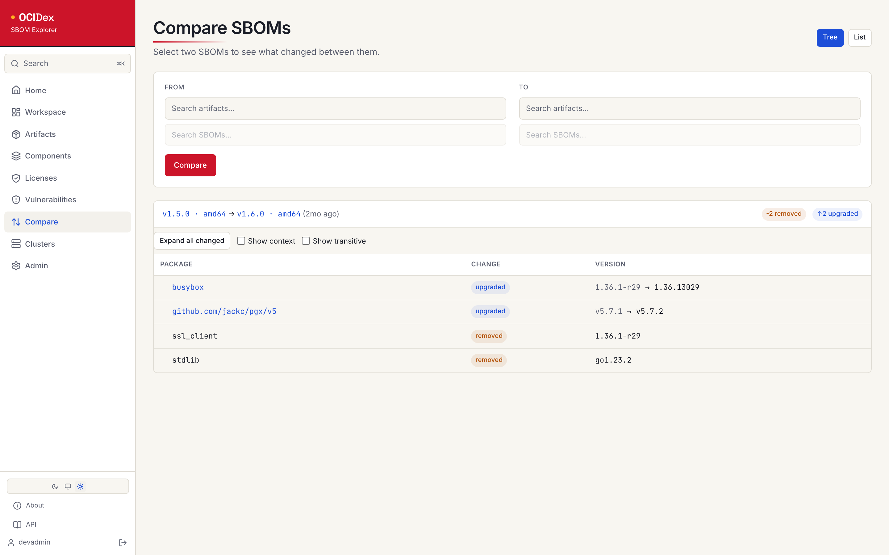

There are two ways to see what changed:

- An artifact's **Changelog** tab compares each version with the one before it, newest first.
- **Compare** (or **Compare SBOMs** on an artifact) compares any two SBOMs you choose, even from
  different artifacts.

Each changed package is **added**, **removed**, **upgraded**, **downgraded** or **modified** (the
version changed, but which way can't be told). The header totals each kind.

## Tree and list

When the SBOMs carry a dependency graph, the diff opens as a **tree**: the image's direct
dependencies at the top, each with chips counting the changes beneath it (`↑3 ↓1 +2`). A change
deep in the graph appears under the dependency that brought it in, so you can see why it changed.

| Control | Effect |
| --- | --- |
| **Show transitive** | Include every transitive dependency, not only the direct ones and their changed branches. |
| **Show context** | Also show unchanged packages, for structure. |
| **Expand all changed** | Open every branch with a change in it. |

**List** shows every changed package in one flat table. It's the fallback when there's no graph.
Your choice of view is remembered.

## Changelog filters

An image often has several SBOMs per version: one per architecture, and sometimes one per base
distribution (`myapp:1.2-alpine` and `myapp:1.2-debian`). A changelog only compares like with like,
so pick the **architecture** and, where there's more than one, the **flavor** to follow. Comparing
across them would show every package as removed and added; the diff page warns you when you try.

## How packages are matched

To call `curl 8.6` → `curl 8.7` an upgrade rather than a removal and an addition, OCIDex decides
which components are the same package, by these rules in order:

1. **The package URL without its version.** Qualifiers that say where a package came from
   (`distro`, `arch`, `epoch`, `repository_url`) are kept, so a Wolfi package never matches an
   Alpine one. Noise like `download_url` and checksums is ignored, so a mirror change isn't a
   change.
2. **Type, group and name**, for a component with no package URL. This is coarser.
3. **Versioned names.** A removed `python-3.11` and an added `python-3.12` fold into one upgrade,
   unless both are installed on one side.

## Troubleshooting

| Symptom | Cause and fix |
| --- | --- |
| "No dependency tree available — showing flat list" | The SBOM has no dependency graph rooted at its subject. Regenerate it with a recent syft. |
| Every package looks added and removed between releases | Two base distributions share one timeline, because their flavor wasn't detected. Use a recent syft, which records the OS, or tag images with a suffix like `-alpine`. |
| Alpine and Wolfi packages match each other | The package URLs lack `distro` qualifiers. syft and apko add them. |
| A Go or Python version bump shows as removed plus added | Both versions were installed at once on one side, so they're deliberately kept apart. |
