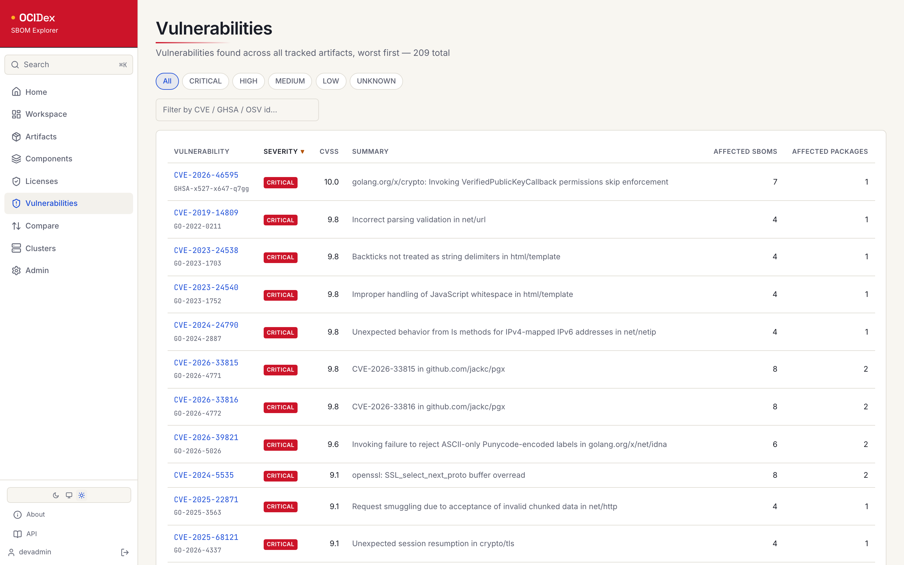

OCIDex matches every SBOM against the grype vulnerability database, and matches everything again
when the database updates, which is daily. How that works is in
[Vulnerability matching](/concepts/vulnerabilities/).

## Where to look

| Question | Where |
| --- | --- |
| What's the worst thing we have? | **Vulnerabilities** in the sidebar: every advisory affecting something you can see, worst first. |
| What's wrong with this image? | The artifact's **Vulnerabilities** tab, for its latest version, or an SBOM's tab for one version. |
| Is this package affected? | A package's page shows the advisories for each version in use. |
| Where are we exposed to this CVE? | The advisory's page lists every affected artifact, and **Running in your clusters** shows where it's deployed. |
| What's exposed in production? | A [cluster's](/guides/use/clusters/) **Vulnerabilities** tab. |

Each finding shows its severity, CVSS score and, where one exists, the **fixed version**. An
advisory published under several ids (a `GHSA-`, a `GO-` and a `CVE-`) is shown once, under one
canonical id, with the others as aliases.

## Triage

A practical order:

1. **Start from what's running.** A cluster's Vulnerabilities tab only counts images that are
   actually deployed.
2. **Sort by severity**, then look for a fixed version. A finding with one is fixed by
   rebuilding with that version.
3. **Check where it came in.** On the SBOM's Packages tab, the dependency tree shows which direct
   dependency pulls the vulnerable package in. That's usually what you upgrade.
4. **Confirm the fix.** After rebuilding, the new version's changelog entry shows the package
   upgraded, and the finding is gone from its Vulnerabilities tab.

## When results look wrong

- **A finding you expected is missing.** The package isn't in the SBOM, or has no package URL.
  Check the SBOM's Packages tab.
- **A distribution package is reported fixed, but the version looks old.** Distributions backport
  fixes. OCIDex uses each distribution's own security tracker, which knows about them.
- **New SBOMs show nothing yet.** Matching runs about a minute after ingest. On a brand-new
  installation, the database download comes first.

## Data sources

The grype database is built daily by Anchore from public feeds, each under its own terms. OCIDex
shows advisory text as published, without modification. The app's **About** page carries the same
list.

| Source | Used for | Terms |
| --- | --- | --- |
| [GitHub Advisory Database](https://github.com/github/advisory-database) | Language ecosystems (Go, npm, PyPI and more) | CC-BY-4.0 |
| [Go Vulnerability Database](https://vuln.go.dev) | Go modules and the standard library | CC-BY-4.0 |
| [NVD](https://nvd.nist.gov) | CVE metadata, CVSS, CPE matching | US government work. This product uses data from the NVD API but is not endorsed or certified by the NVD. |
| [Ubuntu security data](https://github.com/canonical/ubuntu-security-notices) | Ubuntu packages | CC-BY-SA-4.0, © Canonical Ltd. |
| [Debian security tracker](https://security-tracker.debian.org) | Debian packages | Freely redistributable |
| [Red Hat security data](https://access.redhat.com/security/data) | RHEL packages | CC-BY-4.0 |
| Alpine, Wolfi, Chainguard, Amazon, Oracle, SUSE, Fedora, and other distro feeds | Their own packages | Per publisher |
| [FIRST EPSS](https://www.first.org/epss) | Exploit prediction scores | Free to use with attribution |
| [CISA KEV](https://www.cisa.gov/known-exploited-vulnerabilities-catalog) | Known-exploited flag | US government work |

Advisory text from a share-alike source (Ubuntu) stays under that source's license.
