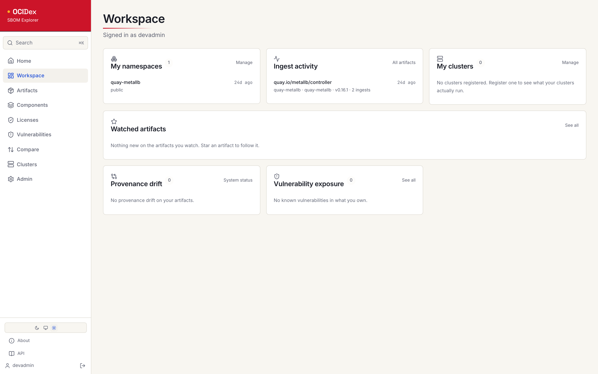

**Workspace** is your own page: what's changed on the things you own and follow. Its panels:

| Panel | What it shows |
| --- | --- |
| **Watched artifacts** | New versions, provenance changes and new vulnerabilities on the artifacts you watch. |
| **Provenance drift** | Images whose signature or attestation status changed, on your artifacts. |
| **Vulnerability exposure** | Vulnerabilities, ranked by how much of what you own they touch. |
| **Ingest activity** | Recent SBOMs arriving in your namespaces: is anything still coming in, and from where? |
| **My namespaces** | The namespaces you own. Everything else on the page hangs off them, so an empty list explains an empty workspace. |
| **My clusters** | Your clusters, and how long since each last reported. |

## Watching an artifact

Choose **Watch** on any artifact's page. From then on, the **Watched artifacts** panel tells you
when it has:

- **a new version**, with the version it replaced;
- **a provenance change**, such as a signature that stopped verifying;
- **a new vulnerability**, with its severity.

Choose **Watch** again to stop. Watching is per user, and notifies in the workspace only: there are
no emails.

## Provenance drift

When a registry has a trust policy, OCIDex checks each image's signatures and attestations, and
checks them again daily. **Drift** is a change in that result, such as an image that verified
yesterday and doesn't today because its signature was removed or the policy changed. Drift on
your artifacts appears in the workspace, and an SBOM's **Provenance** tab shows its history.
